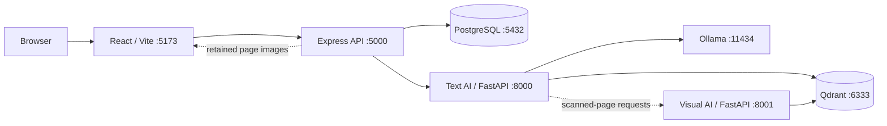

# System Architecture

## Overview

EKIP is a local-first web application composed of a React client, Express API,
PostgreSQL, FastAPI AI services, Qdrant, and Ollama. Docker Compose provides a
development stack. Each service can also be run directly on Windows when its
dependencies are installed locally.

## Service responsibilities

| Service | Responsibility | Persistent data |
| --- | --- | --- |
| Frontend | Signup, login, upload, search, settings, users, integrations | None |
| Backend | Authentication, authorization, organization and document APIs, AI proxy, Drive integration | PostgreSQL records and retained originals |
| PostgreSQL | Accounts, organizations, workspaces, departments, document metadata, refresh tokens, answer history | Database volume |
| Text AI service | Parsing, chunking, indexing, retrieval, reranking, generation, citations | Text vectors and payloads in Qdrant |
| Visual AI service | Scanned-page rendering/indexing and image-grounded answers | Visual vectors in Qdrant and page images in shared storage |
| Qdrant | Vector collections for text and visual data | Qdrant volume |
| Ollama | Local text generation using `llama3.2:3b` | Model volume |

## Request flows

### Signup and login

1. The browser calls the backend.
2. The backend creates organization-scoped records and the initial Admin, or
   verifies login credentials.
3. The backend issues an access token and rotating refresh token. The
   refresh-token hash is stored in PostgreSQL.

### Document upload

1. The browser uploads a supported file to `POST /ai/ingest`.
2. The backend authenticates the request, derives tenant and user identity from
   the verified token, saves metadata and retains the original where supported.
3. The backend sends the file and access metadata to the AI service.
4. The AI service parses pages, chunks content, creates embeddings, and stores
   payloads in Qdrant. Scanned PDFs may also be forwarded to the visual service.
5. Processing progress is reported to the backend for the UI to display.

### Question answering

1. The browser sends a question to the backend.
2. The backend forwards it with authorization context derived from the
   validated token; callers cannot choose another tenant's context.
3. The AI service filters candidate content by organization, workspace,
   department, and allowed role before text reaches ranking or generation.
4. Dense and sparse results are fused and reranked. Ollama generates a
   grounded answer; citations map back to document and page metadata.
5. The backend stores answer history for the user and returns the response.

When the user has accessible visual-indexed pages, the text service can call
the visual service and combine/choose results according to the pipeline logic.
The visual path is optional and needs additional compute resources.

## Authorization boundaries

- The backend verifies JWTs and applies role-gated routes.
- Organization/workspace/department/role values used by protected AI operations
  are derived from the verified user, not trusted from arbitrary request data.
- Document listing, preview, deletion, and retrieval are scoped to the user's
  organization and access metadata.
- Qdrant access filters are applied before passages are returned from the
  retrieval service; filtering after generation would be too late.
- Google Drive's own sharing rules are not imported as EKIP permissions.
  Imported documents use the EKIP role list selected during import.

## Network addresses

From the browser and host processes, use `localhost` and published ports. From
inside the Compose network, use service names:

| Connection | Compose address |
| --- | --- |
| Backend to PostgreSQL | `postgres:5432` |
| Backend to text AI | `ai-service:8000` |
| Text AI to Qdrant | `qdrant:6333` |
| Text AI to Ollama | `ollama:11434` |
| Text AI to backend | `backend:5000` |
| Text AI to visual AI | `ai-service-visual:8001` |

## Persistence and privacy

Compose named volumes persist the database, vector index, Ollama model data,
and retained uploads across ordinary `docker compose down`. Removing volumes
deletes their contents. Never commit secrets or real private documents to the
repository.
