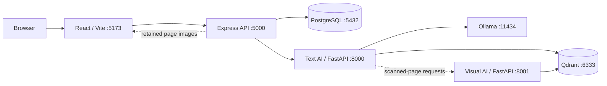

# EKIP Project Report — Technical Source Pack

Generated from repository inspection. This is a documentation-only report and does not change application code. Status labels: **Implemented**, **Partial**, **Optional**, **Future**.

## 1. Executive Summary

EKIP (Enterprise Knowledge Intelligence Platform) is a local-first document knowledge platform. It combines a React/Vite frontend, an Express/Prisma backend, PostgreSQL, a FastAPI text AI service, Qdrant, Ollama, and an optional visual AI service. Users can create organizations, authenticate, upload supported documents, ask questions, receive citation-backed answers, preview retained originals, manage users/workspaces/departments/roles, and import Google Drive files. Authorization is enforced in the backend and retrieval layers, not only in the UI.

Core text RAG is **Implemented**. Administration and Google Drive integration are **Implemented / Partial** depending on frontend control coverage. Visual document understanding is **Optional** and requires additional compute. Production readiness items remain **Future**.

## 2. Project Scope, Goals, and Non-Goals

### Goals
- Organize company documents by organization, workspace, department, and role.
- Answer questions only from content the signed-in user is permitted to access.
- Provide citations that map to document and page metadata.
- Support local development through Docker Compose and direct process startup.
- Keep identity and tenant context derived from verified credentials.

### Non-goals / not claimed
- Production hosting, TLS, backups, scaling, HA, or managed observability.
- Support for formats beyond PDF, DOCX, XLSX, and TXT.
- Production-grade retrieval evaluation or complete automated integration coverage.
- Import of Google Drive sharing permissions as EKIP permissions.

## 3. Repository and Technology Stack

| Area | Technology | Evidence |
| --- | --- | --- |
| Frontend | React, Vite, React Router | `apps/frontend/src/App.jsx`, `package.json` |
| Backend | Node.js, Express, Prisma, PostgreSQL | `apps/backend/src/app.js`, `src/prisma/schema.prisma` |
| Text AI | Python, FastAPI, sentence-transformers, cross-encoder, Ollama | `apps/ai-service/main.py`, `requirements.txt` |
| Vector DB | Qdrant | `docker-compose.yml`, AI handbooks |
| Visual AI | FastAPI, ColPali, Qwen2-VL, Pillow | `apps/ai-service-visual/main.py` |
| Deployment | Docker Compose, GitHub Actions | `docker-compose.yml`, `.github/workflows/ci.yml` |

Repository map:

| Path | Responsibility |
| --- | --- |
| `apps/frontend` | React/Vite user interface |
| `apps/backend` | Express APIs, authentication, Prisma models, integrations |
| `apps/ai-service` | Text document ingestion and RAG API |
| `apps/ai-service-visual` | Optional scanned-page indexing and visual QA |
| `docs` | Architecture, service handbooks, deployment notes, roadmap |
| `docker-compose.yml` | Local multi-service development stack |

## 4. System Architecture and Service Responsibilities

| Service | Responsibility | Persistent data |
| --- | --- | --- |
| Frontend | Signup, login, upload, search, settings, users, integrations | None |
| Backend | Authentication, authorization, organization and document APIs, AI proxy, Drive integration | PostgreSQL records and retained originals |
| PostgreSQL | Accounts, organizations, workspaces, departments, document metadata, refresh tokens, answer history | Database volume |
| Text AI service | Parsing, chunking, indexing, retrieval, reranking, generation, citations | Text vectors and payloads in Qdrant |
| Visual AI service | Scanned-page rendering/indexing and image-grounded answers | Visual vectors in Qdrant and page images in shared storage |
| Qdrant | Vector collections for text and visual data | Qdrant volume |
| Ollama | Local text generation using `llama3.2:3b` | Model volume |

Request flows:
- Signup/login: browser calls backend; backend creates organization-scoped records or verifies credentials; issues access and rotating refresh tokens.
- Document upload: browser uploads to `POST /ai/ingest`; backend authenticates, derives tenant/user identity, saves metadata and retains original where supported; backend sends file and access metadata to AI service; AI service parses, chunks, embeds, and stores payloads in Qdrant; progress is reported to backend.
- Question answering: browser sends question to backend; backend forwards with authorization context derived from validated token; AI service filters candidate content by organization, workspace, department, and allowed role before ranking/generation; dense and sparse results are fused and reranked; Ollama generates grounded answer; citations map to document/page metadata; backend stores answer history.

Authorization boundaries:
- Backend verifies JWTs and applies role-gated routes.
- Organization/workspace/department/role values used by protected AI operations are derived from the verified user, not trusted from arbitrary request data.
- Document listing, preview, deletion, and retrieval are scoped to the user organization and access metadata.
- Qdrant access filters are applied before passages are returned.
- Google Drive sharing rules are not imported as EKIP permissions.
## 5. Data Model and Persistence

Prisma schema: `apps/backend/src/prisma/schema.prisma`. Database: PostgreSQL. Migrations under `apps/backend/src/prisma/migrations/`.

Core entities:

| Entity | Key fields | Notes |
| --- | --- | --- |
| Organization | id, name, owner_user_id | Top-level tenant boundary |
| Workspace | id, org_id, name | Organization-scoped workspace |
| Department | id, workspace_id, name, description, is_default | Document and user scoping boundary |
| User | id, department_id, role_id, email, password_hash, active, failed_login_attempts, locked_until | Authenticated identity |
| OrganizationRole | id, org_id, name, permissions, is_owner | Custom RBAC role |
| Document | id, department_id, filename, file_type, status, stage, progress, chunk_count, storage_key, uploaded_by, created_at | Document metadata and processing state |
| DocumentRoleAccess | document_id, role_id | Role-based document access |
| UserAuthorizedDepartment | user_id, department_id | Cross-department grants |
| AiRequestProgress | request_id, user_id, stage, created_at | Ask progress tracking |
| AiAnswerHistory | id, request_id, user_id, question, answer, sources, model, has_answer, created_at | Retained answer history |
| RefreshToken | id, user_id, token_hash, expires_at, created_at | Hashed rotating refresh tokens |
| IntegrationToken | id, user_id, provider, access_token, refresh_token, expires_at, created_at | Encrypted/stored OAuth tokens |

Relationships enforce organization/workspace/department scoping. `DocumentRoleAccess` allows document-level role grants. `UserAuthorizedDepartment` allows a user to access multiple departments within the same workspace. Migration history indicates incremental feature additions: refresh tokens, document upload status/progress, AI request progress, answer history, user active flag, integration tokens, account lockout, custom roles, department management, authorized departments, and default department.

## 6. Authentication, Authorization, and RBAC

### Authentication
- Access JWTs and rotating refresh tokens.
- Backend verifies access tokens and attaches user, organization, workspace, department, and role information to `req.user`.
- Protected AI requests forward validated identity context to the AI service.
- Password policy and account lockout enforced on credential setting/login.
- Refresh tokens stored hashed; successful refresh replaces previous token.

### Permission catalog
`documents:search`, `documents:upload`, `documents:delete`, `documents:reindex`, `documents:manage_access`, `drive:connect`, `drive:import`, `users:manage`, `roles:manage`, `departments:manage`, `workspace:manage`, `analytics:view`.

Owner users receive all permissions. Non-owner users receive role permissions. `is_owner` is derived by comparing the user ID with the organization owner.

### Roles
Roles defined in backend/Prisma: Admin, Manager, Employee, Intern. The backend also supports custom organization roles with permission arrays. Admin routes require Admin role in documentation; implementation uses permission gates such as `users:manage`, `workspace:manage`, etc.

### Authorization boundaries
- Backend derives tenant context from verified token, not client payload.
- Document access uses `documentAccessWhere` and `qdrantAccessFilter`.
- Owners and users with `documents:manage_access` can manage broader document access.
- Non-managers are restricted to their own department(s) and allowed roles.

## 7. Backend API Surface

### Authentication and organization
| Method/Path | Purpose |
| --- | --- |
| `POST /organizations` | Create organization, initial workspace/department, first Admin |
| `POST /auth/login` | Verify credentials and issue tokens |
| `POST /auth/refresh` | Rotate refresh token |
| `POST /auth/logout` | Revoke refresh token |
| `GET /auth/me` | Return authenticated identity |
| `POST /auth/change-password` | Change password |

### Admin APIs (`/admin`, authenticated)
| Method/Path | Purpose |
| --- | --- |
| `GET /admin/analytics/queries` | Organization query counts for recent days |
| `GET/POST /admin/users` | List or create users |
| `PATCH /admin/users/:id` | Update user details |
| `POST /admin/users/:id/reset-password` | Reset password |
| `PATCH /admin/users/:id/deactivate` | Deactivate user |
| `PATCH /admin/users/:id/reactivate` | Reactivate user |
| `GET/POST /admin/workspaces` | List or create workspaces |
| `GET /admin/workspaces/:workspaceId` | Workspace dashboard data |
| `PATCH /admin/workspaces/:workspaceId` | Update workspace |
| `GET/POST /admin/departments` | List or create departments |
| `GET/PATCH/DELETE /admin/departments/:id` | Department operations |

### AI and document APIs (`/ai`, authenticated)
| Method/Path | Purpose |
| --- | --- |
| `POST /ai/ask` | Query knowledge base |
| `POST /ai/ask/progress` | Update ask progress |
| `GET /ai/ask/progress/:requestId` | Get ask progress |
| `GET /ai/history` | List answer history |
| `DELETE /ai/history` | Clear answer history |
| `POST /ai/ingest` | Upload and process document |
| `POST /ai/documents/:id/reindex` | Reindex document |
| `POST /ai/documents/:id/progress` | Update document progress |
| `GET /ai/documents/:id/preview` | Stream authorized retained original |
| `PATCH /ai/documents/:id/access` | Update document access |
| `GET /ai/documents/:id/page-image/:page_num` | Stream rendered visual page image |
| `GET /ai/documents` | List authorized documents |
| `DELETE /ai/documents/:id` | Delete document and indexed data |
| `GET /ai/health` | Check AI service connection |

Uploads have a 50 MB limit. User and tenant fields come from authenticated context.

### Google Drive APIs (`/integrations`)
| Method/Path | Purpose |
| --- | --- |
| `GET /integrations/google/connect` | Start OAuth connection |
| `GET /integrations/google/callback` | OAuth redirect callback |
| `GET /integrations/google/status` | Check connection status |
| `GET /integrations/google/folders` | List folders |
| `GET /integrations/google/files` | List supported Drive files |
| `POST /integrations/google/import` | Import files with EKIP role access |
| `DELETE /integrations/google/disconnect` | Remove connection |

### Roles APIs (`/roles`)
| Method/Path | Purpose |
| --- | --- |
| `GET /roles` | List roles (permission-gated) |
| `POST /roles` | Create role |
| `PATCH /roles/:id` | Update role |
| `DELETE /roles/:id` | Delete role |

## 8. Frontend Application Structure

Frontend routes in `apps/frontend/src/App.jsx`:

| Route | Page/Component | Permission gating |
| --- | --- | --- |
| `/login` | Login | Public |
| `/signup` | Signup | Public |
| `/app` | DashboardLayout | Authenticated |
| `/app/account` | AccountSettings | All authenticated users |
| `/app/search` | Search | `documents:search` |
| `/app/upload` | Upload | Document management permissions |
| `/app/users` | ManageUsers | `users:manage` |
| `/app/roles` | RoleManagement | `roles:manage` |
| `/app/departments` | DepartmentEdit | `departments:manage` or `workspace:manage` |
| `/app/analytics` | Analytics | `analytics:view` |
| `/app/settings` | WorkspaceSettings | `workspace:manage` |
| `/app/integrations` | Integrations | `drive:connect` or `drive:import` |

Navigation in `apps/frontend/src/lib/nav.js` filters items by user permissions. API client in `apps/frontend/src/lib/apiClient.js` handles access tokens, refresh-token rotation, 401 retry, and multipart uploads. Auth context restores sessions from refresh token.

Frontend components include citation previews (`AnswerResult`, `CitationTab`, `PageImagePreview`, `TextPreviewModal`), document preview components, dashboard chart, and shared UI primitives.
## 9. Text Document Ingestion Pipeline

Supported formats: PDF, DOCX, XLSX, TXT. Maximum upload size: 50 MB.

Pipeline behavior:
- Backend authenticates and derives tenant identity from the verified token.
- Document metadata is created with processing status, stage, and progress.
- The original file is retained when possible, enabling document preview and citation page rendering.
- Backend forwards file, document metadata, workspace ID, department ID, role IDs, and user ID to AI service.
- AI service parses text, performs OCR fallback for scanned PDFs, chunks content, generates embeddings, and stores vectors in Qdrant.
- Progress is reported back to backend.
- Documents receive access metadata including workspace ID, department ID, and allowed role IDs.
- Reindexing is supported for eligible documents.

Implementation status: **Implemented** for text formats. OCR fallback is **Partial** and depends on PyMuPDF/Tesseract availability.

## 10. Retrieval, Hybrid Search, and Reranking

Retrieval is hybrid:
- Dense embeddings using `BAAI/bge-base-en-v1.5`.
- Sparse retrieval using BM25 via `rank_bm25`.
- Reciprocal Rank Fusion combines dense and sparse rankings.
- Cross-encoder reranking using `BAAI/bge-reranker-base`.
- Final results are filtered by Qdrant access payload before ranking.

Access filtering:
- `organization_id` equals user organization.
- `workspace_id` equals user workspace.
- `department_id` equals user department or authorized departments.
- `allowed_role_ids` intersects user role.

Retrieval parameters:
- Top K candidates.
- Reranking candidate pool.
- RRF constant.
- Embedding and reranker model identifiers.

Status: **Implemented**.

## 11. Answer Generation and Citation Verification

Answer generation uses Ollama model `llama3.2:3b` at `http://localhost:11434` by default. The service:
- Builds a context from reranked passages.
- Generates an answer grounded in retrieved context.
- Selects verbatim supporting quotations from context.
- Extracts citations from generated text.
- Verifies citation text against supporting quotations.
- Returns sources with document ID, filename, page number, and text.
- Handles no-answer cases when evidence is insufficient.
- Stores answer history and query progress.

Status: **Implemented**. Quality depends on model, prompt, and document content. Citation verification is rule-based and should not be assumed to catch every unsupported claim.

## 12. Optional Visual Document Understanding

The visual service is separate and optional. It supports:
- Listing visual collections.
- Indexing scanned PDF pages.
- Querying visual pages with ColPali.
- Generating image-grounded answers with Qwen2-VL.
- Rendering and previewing page images.
- Forwarding selected text queries to visual endpoints when the primary text path finds no answer.

Runtime requirements:
- GPU recommended.
- ColPali and Qwen2-VL models.
- Shared storage for page images.
- Additional latency and memory.

Status: **Optional**. Text path remains the default.
## 13. Document Lifecycle and Access Management

Implemented lifecycle operations:
- List authorized documents with metadata.
- Preview retained original document.
- Render page images for visual citations.
- Delete document and indexed data.
- Reindex document.
- Update document access metadata.
- Track processing status, stage, and progress.

Access management:
- Documents have department, workspace, and allowed role IDs.
- Access updates can change role access.
- Authorization is enforced on list, preview, delete, reindex, and access update.
- Owners or users with `documents:manage_access` can manage access beyond their own grants.

Status: **Implemented**.

## 14. Google Drive Integration

Backend supports Google Drive OAuth and file import:
- OAuth authorization and callback.
- Encrypted token storage.
- Connection status.
- Folder and file listing.
- Import of supported file types into EKIP.
- Role access assignment at import.
- Disconnect.

Important boundary: Google Drive sharing permissions are not imported as EKIP permissions. Imported files receive EKIP role access selected by the importing user.

Status: **Implemented / Partial**. Core flows are implemented; frontend coverage and operational validation may vary.

## 15. Deployment and Runtime Configuration

Docker Compose services:
- PostgreSQL 15
- Qdrant
- Ollama
- Backend
- Frontend
- AI service
- Visual AI service (optional)

Ports:
- Frontend 5173
- Backend 5000
- AI service 8000
- Visual AI service 8001
- Qdrant 6333
- PostgreSQL 5432
- Ollama 11434

Environment configuration:
- Backend: database URL, JWT secret, AI service URL, Google OAuth, encryption, storage path.
- AI service: Qdrant URL, Ollama URL, model names, reranker model.
- Visual service: model names, Qdrant URL, page image storage.
- Frontend: API base URL.

Status: **Implemented** for local development. Production deployment is **Future**.

## 16. Security Controls and Privacy Boundaries

Controls:
- JWT-based authentication.
- Refresh token rotation and revocation.
- Password policy and account lockout.
- Role-based permission checks.
- Tenant-scoped data access.
- Qdrant payload filtering.
- Encrypted Google OAuth tokens.
- 50 MB upload limit.
- Retained original document access checks.

Privacy boundaries:
- Questions and answers are stored as answer history.
- Uploaded documents are processed and indexed.
- Visual page images may be retained for visual citations.
- Google Drive files are imported into EKIP; Drive permissions are not mirrored.
- Local Ollama keeps generation local by default.

Status: **Implemented / Partial**. Production hardening is **Future**.
## 17. Testing, CI, and Quality Gates

Backend tests:
- Jest unit and integration tests.
- Prisma migrations in CI.
- Auth, RBAC, organization, user, department, role, document, answer history, and integration tests.

Frontend tests:
- Vitest component tests.
- Playwright end-to-end tests.

CI workflow: `.github/workflows/ci.yml`
- Backend: install, migrate, test.
- Frontend: install, lint, build, unit and e2e tests.

Status: **Partial**. Coverage is useful but not exhaustive for all routes, edge cases, or visual service behavior.

## 18. Observability, Limitations, and Risks

Observability:
- Health endpoint at `GET /ai/health`.
- Document and ask progress tracking.
- CI test results.

Limitations:
- Only PDF, DOCX, XLSX, TXT are supported.
- Visual service is optional and GPU-dependent.
- OCR quality varies by document and runtime dependencies.
- Citation verification is rule-based.
- No production deployment hardening.
- Answer history and uploaded content are retained locally.
- Google Drive permission mirroring is not implemented.

Risks:
- Model availability and memory constraints.
- Vector store and database backup not configured.
- Token storage and encryption key management require production review.
- Access filter correctness is critical.
- Large file uploads and concurrent indexing may affect performance.

Status: **Partial**.

## 19. Roadmap and Future Work

Likely future work based on repository structure and docs:
- Production deployment hardening and managed observability.
- Expanded document formats and connector support.
- Stronger evaluation and regression testing for retrieval/generation.
- Visual service productionization.
- Google Drive permission import or richer sync.
- Additional admin analytics and audit logs.
- Improved citation confidence and answer quality metrics.

Status: **Future**.

## 20. Appendix: Evidence Index, Status Labels, and File Inventory

### Status labels
- **Implemented**: Present and operational in repository.
- **Partial**: Present but incomplete or not fully validated.
- **Optional**: Available behind additional runtime requirements.
- **Future**: Not implemented or not production-ready.

### Key evidence files
| File | Evidence for |
| --- | --- |
| `README.md` | Product overview and service map |
| `docs/architecture.md` | Architecture and data flow |
| `docs/ai-service-handbook.md` | Text ingestion, retrieval, generation |
| `docs/ai-service-visual-handbook.md` | Optional visual service |
| `docs/backend-handbook.md` | Backend APIs and RBAC |
| `docs/frontend-handbook.md` | Frontend structure and routes |
| `docs/deployment.md` | Local deployment and ports |
| `docs/roadmap.md` | Future work |
| `apps/backend/src/prisma/schema.prisma` | Data model |
| `apps/backend/src/app.js` | Backend route mounting |
| `apps/frontend/src/App.jsx` | Frontend routes |
| `apps/frontend/src/lib/nav.js` | Navigation gating |
| `apps/ai-service/main.py` | Text AI entry point |
| `apps/ai-service-visual/main.py` | Visual AI entry point |
| `docker-compose.yml` | Service topology |
| `.github/workflows/ci.yml` | CI and quality gates |

### File inventory summary
| Area | Representative files |
| --- | --- |
| Backend | `apps/backend/src/app.js`, `src/prisma/schema.prisma`, `src/auth/*`, `src/middleware/*`, `src/routes/*`, `src/services/*` |
| Frontend | `apps/frontend/src/App.jsx`, `src/lib/*`, `src/pages/*`, `src/components/*` |
| AI | `apps/ai-service/main.py`, `apps/ai-service-visual/main.py` |
| Docs | `docs/*.md` |
| Infra | `docker-compose.yml`, `.github/workflows/ci.yml` |

### Unverified areas
- Live runtime behavior, model loading, and end-to-end query latency.
- Production deployment, backups, and observability.
- Full automated test coverage and edge-case behavior.
- Visual service GPU performance.
- Google Drive import operational validation.
